# HyperDeX

Two desktop layouts for rooted Xiaomi and Redmi tablets. Keep the centered **HyperOS Workstation** dock, or switch to **Classic DeX** for a full-width taskbar, app search, and desktop window controls.

[Download a tagged release](https://github.com/ctrl-spidey/HyperDeX/releases/latest) · [Changelog](CHANGELOG.md) · [Report an issue](https://github.com/ctrl-spidey/HyperDeX/issues)

## Choose your desktop

| Workstation | Classic DeX |
| --- | --- |
| Xiaomi’s stock desktop and centered dock | Full-width taskbar with running apps and a system tray |
| Native launcher and window controls | Minimize, maximize, restore, and close from the window caption |
| Switch back from the companion app or Quick Settings tile | Open the app grid, search by name, and adjust taskbar size and spacing |

## Screenshots

Explore HyperDeX on a tablet, including the desktop layouts, windowed apps, and companion settings. Tap any image to view it at full resolution.

### Desktop experience

| Desktop preview | Desktop preview |
| :---: | :---: |
| 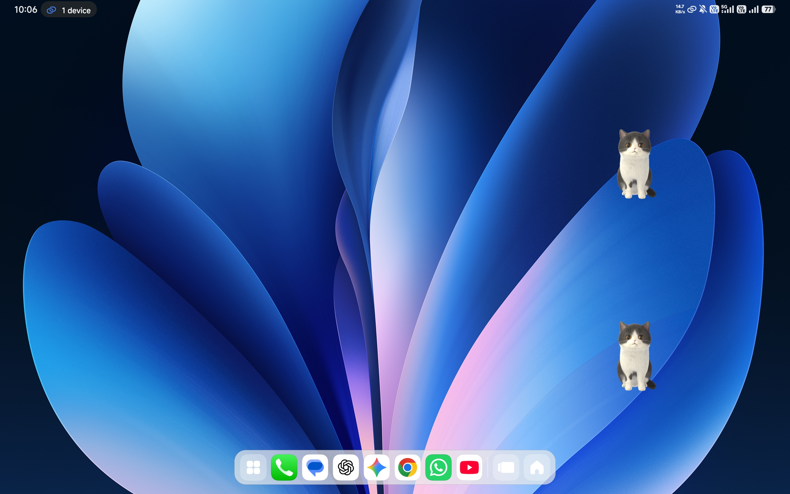 | 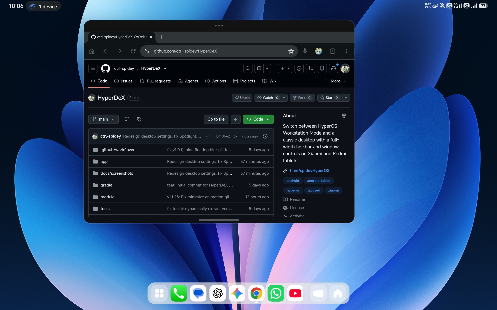 |
| 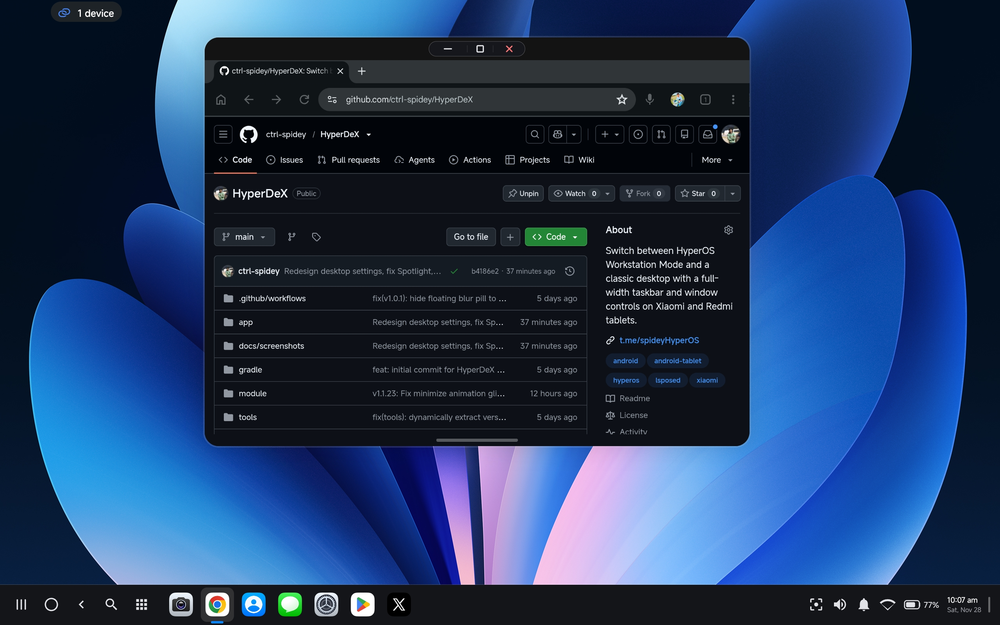 | 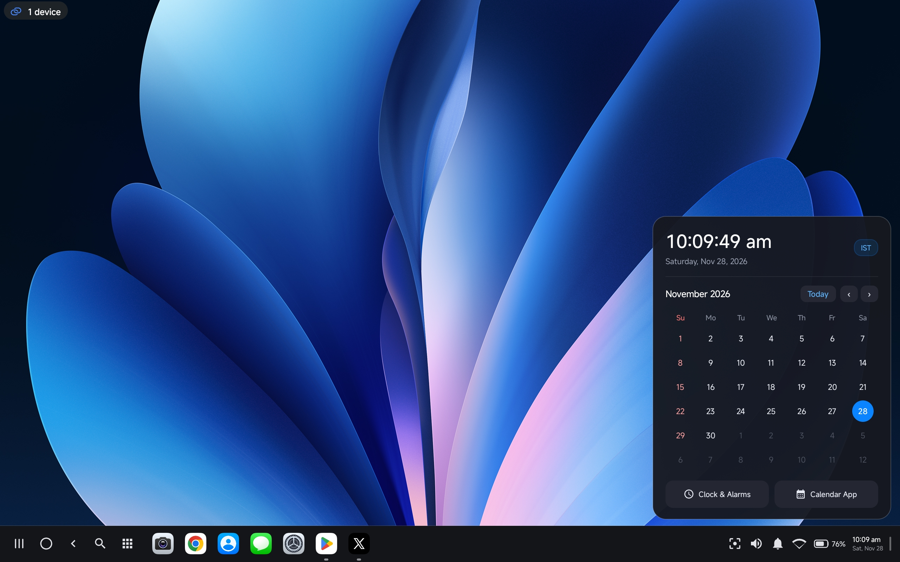 |
| 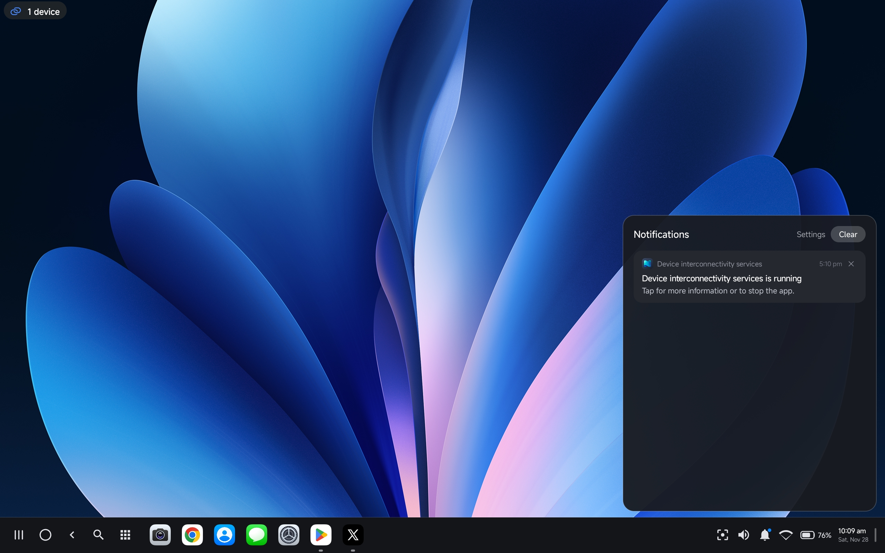 | 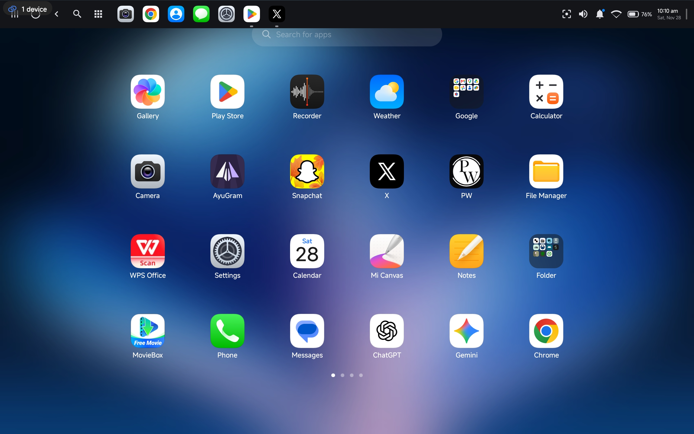 |
| 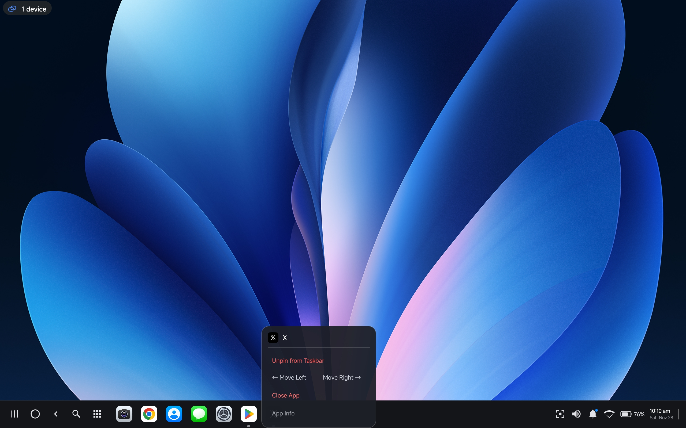 | 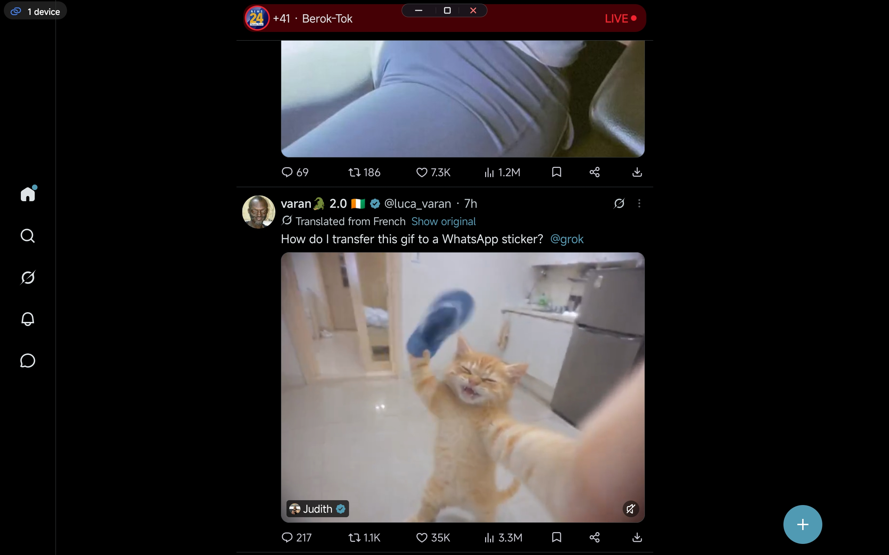 |

### Apps and windowed workflow

| App preview | App preview |
| :---: | :---: |
| 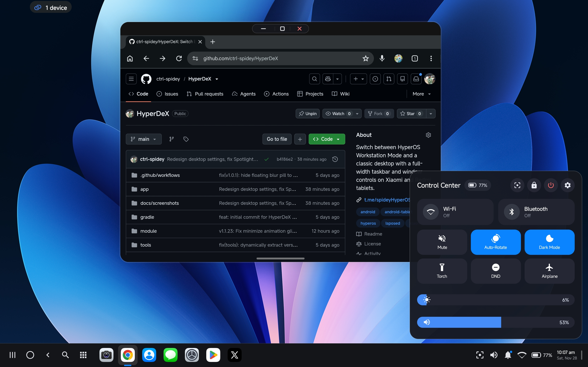 | 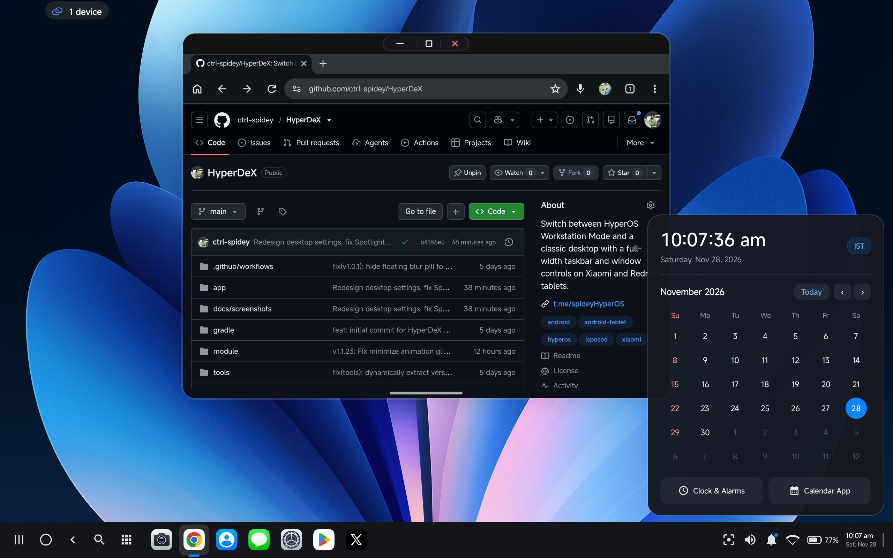 |

### HyperDeX companion app

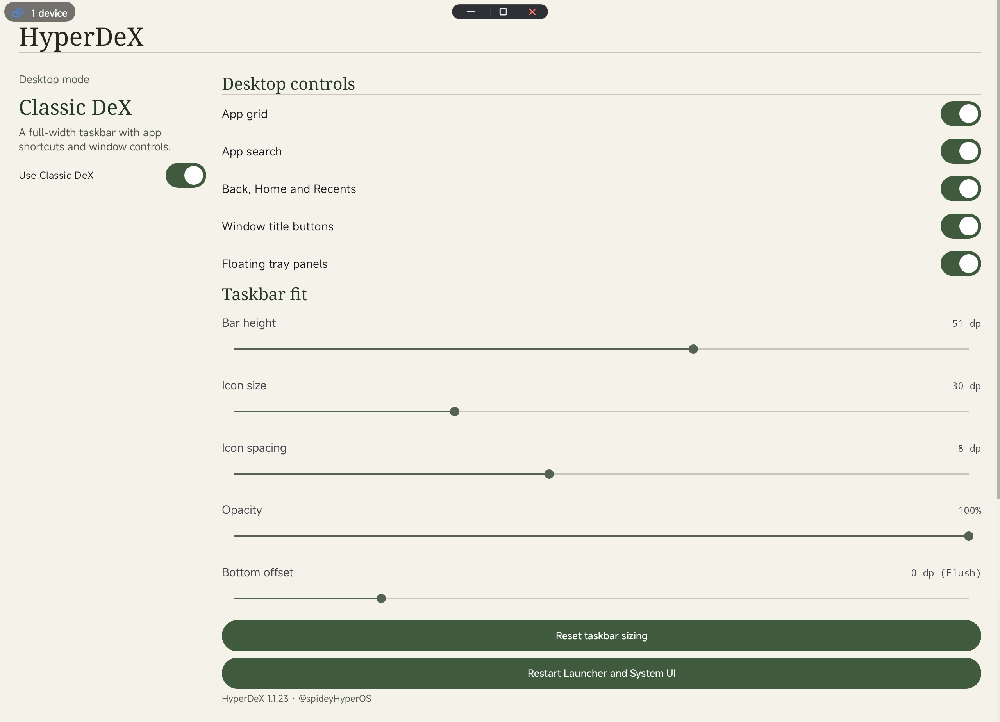

## Install

You’ll need a rooted HyperOS tablet with working Workstation Mode, a compatible Zygisk setup, and LSPosed or Vector. HyperDeX uses Xiaomi Launcher and System UI internals, so compatibility depends on your firmware.

1. Download the **versioned ZIP** from [Releases](https://github.com/ctrl-spidey/HyperDeX/releases). Flash it through KernelSU, Magisk, or APatch. The installer bundles the companion APK.
2. Open your Xposed manager and enable **HyperDeX**. Verify that **System Launcher** (`com.miui.home`) and **System UI** (`com.android.systemui`) are in scope.
3. Reboot, enter Xiaomi’s **Workstation Mode**, then open HyperDeX and select **Use Classic DeX**. Turn that switch off to return to the stock dock.
4. For quick switching, edit the Quick Settings shade and add the HyperDeX tile.

**Upgrading from v1.1.23 or earlier:** v1.1.24 uses a dedicated signing key. If Android reports a signature mismatch, uninstall the older companion APK first, then install the new version and re-enable its Xposed scope. Uninstalling may clear app settings.

The release also includes a standalone APK for an existing Xposed setup. If installing manually, grant the companion permission to write its settings from an authorized ADB shell:

```sh
pm grant com.spiderman4u.hyperdex android.permission.WRITE_SECURE_SETTINGS
```

## Build

Use JDK 17 and Android SDK Platform 35.

```sh
./gradlew assembleDebug
```

The APK is written to `app/build/outputs/apk/debug/app-debug.apk`. The [release workflow](.github/workflows/build.yml) packages the release APK, module ZIP, and checksums. Screenshots above show HyperDeX running on a tablet.

[Apache License 2.0](LICENSE)
